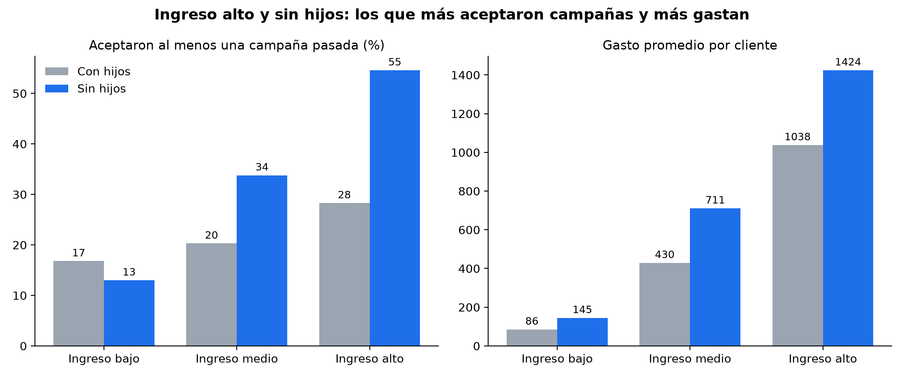

# Segmentación de clientes por ingreso y hogar: ¿a quién dirigir la próxima campaña de marketing?

Análisis en Python que identifica qué segmentos de clientes aceptaron más campañas de marketing en el pasado y gastan más, para decidir a quién priorizar en la próxima campaña. La recomendación se valida con una prueba piloto con grupo de control.

## Problema de negocio

Una empresa que contacta a toda su base de clientes con cada campaña gasta esfuerzo en clientes que casi no responden. En este dataset, solo el 27% de los clientes aceptó al menos una de las seis campañas pasadas.

**Pregunta:** ¿qué segmento de clientes, definido por ingreso y composición del hogar, aceptó más campañas y gasta más?

**Importante:** la aceptación que se mide es **histórica** (campañas ya realizadas). Describe quién aceptó antes y no garantiza la misma tasa en una campaña nueva.

## Datos

- **Fuente (enlace directo):** [https://www.kaggle.com/datasets/imakash3011/customer-personality-analysis](https://www.kaggle.com/datasets/imakash3011/customer-personality-analysis)
- **Nombre:** Customer Personality Analysis (Kaggle)
- **Archivo:** `marketing_campaign.csv`, 2.240 filas y 29 columnas, separado por tabulaciones.
- El archivo **no está incluido** en este repositorio: hay que descargarlo desde el enlace anterior (ver "Cómo ejecutar").

## Stack tecnológico

- Python 3
- pandas (limpieza y agregaciones)
- matplotlib (gráfico)
- Git y GitHub (versionado)

## Metodología

Se trabajó con CRISP-DM y sprints cortos, empezando por una **rebanada delgada**: la porción mínima que atraviesa todas las fases y ya responde parte de la pregunta.

| Fase CRISP-DM | Qué se hizo en la rebanada #1 |
|---|---|
| Comprensión del negocio | Pregunta de negocio y definición de segmentos (ingreso y hogar) |
| Comprensión de los datos | Carga del CSV, revisión de nulos y valores atípicos en `Income` |
| Preparación de los datos | Limpieza mínima (criterio JBGE) y variables `acepto_alguna`, `gasto_total`, `hogar`, `ingreso` |
| Modelado | Análisis descriptivo: tasa de aceptación histórica y gasto por segmento |
| Evaluación | Verificaciones automáticas, gráfico y lectura del resultado |
| Despliegue | Presentación ejecutiva, prueba piloto propuesta y este repositorio |

**Plan de sprints:** el Sprint 1 (rebanada #1) está completo. Los sprints 2 y 3 (análisis por canal de compra, diccionario de variables y análisis por campaña) están planificados y todavía no se ejecutaron.

**Criterio JBGE (lo justo y necesario):** solo se limpió lo necesario para esta pregunta: se excluyeron 25 filas (24 sin ingreso y 1 con un ingreso atípico de 666.666), quedando 2.215 clientes. Quedó afuera el análisis por canal de compra, los modelos predictivos y la segmentación avanzada.

**Control de calidad:** el script incluye verificaciones automáticas (`assert`). Si alguna falla, el script se detiene con un mensaje: que los segmentos contemplen los 2.215 registros, que haya 6 segmentos y que los porcentajes de clientes y de gasto sumen 100%.

## Hallazgos clave

- **Ingreso alto y sin hijos** es el segmento que más aceptó campañas y más gasta: 441 clientes (19,9% de la base) concentran el 46,7% del gasto, y el 54,6% aceptó al menos una de las seis campañas pasadas, el doble del promedio general (27,3%).
- El gasto promedio por cliente crece con el ingreso: el tramo alto gasta unas 13 veces más que el bajo.
- En ingreso medio y alto, los hogares sin hijos aceptaron más campañas pasadas que los que tienen hijos.
- **Ingreso bajo con hijos** es el 28,2% de la base y aporta solo el 4,0% del gasto.
- Son tasas históricas: el 54,6% del segmento ganador no garantiza esa tasa en una campaña nueva. Por eso se propone la prueba piloto de la sección siguiente.

| Ingreso | Hogar | Clientes | % de clientes | Aceptó alguna campaña pasada | Gasto promedio | % del gasto |
|---|---|---|---|---|---|---|
| Bajo | Con hijos | 624 | 28,2% | 16,8% | 86 | 4,0% |
| Bajo | Sin hijos | 115 | 5,2% | 13,0% | 145 | 1,2% |
| Medio | Con hijos | 661 | 29,8% | 20,3% | 430 | 21,1% |
| Medio | Sin hijos | 77 | 3,5% | 33,8% | 711 | 4,1% |
| Alto | Con hijos | 297 | 13,4% | 28,3% | 1.038 | 22,9% |
| Alto | Sin hijos | 441 | 19,9% | 54,6% | 1.424 | 46,7% |



## Validación propuesta: prueba piloto

- **Objetivo:** comprobar si dirigir la próxima campaña al segmento de ingreso alto sin hijos mejora realmente la conversión.
- **Diseño:** dividir al azar los 441 clientes del segmento en dos grupos de unos 220: el de tratamiento recibe la campaña y el de control no.
- **Métrica:** conversión, es decir, el porcentaje de clientes de cada grupo que acepta la campaña en el período de medición.
- **Decisión:** si la conversión del grupo de tratamiento supera con claridad a la del control, se escala la campaña al segmento. Si no, se revisa la segmentación.
- **Limitación:** con unos 220 clientes por grupo solo se detectan diferencias grandes, de alrededor de 13 puntos porcentuales (con 80% de potencia y 5% de significancia).
- **Estado:** es un diseño propuesto; todavía no se ejecutó, porque requiere lanzar una campaña real.

## Cómo ejecutar

1. Clonar el repositorio y entrar a la carpeta (en cualquier sistema operativo):

```bash
git clone https://github.com/Tobias-Cavodeassi/analisis-segmentos-clientes-marketing.git
cd analisis-segmentos-clientes-marketing
```

2. Crear y activar un entorno virtual, según el sistema operativo.

**Windows con PowerShell:**

```powershell
python -m venv venv
venv\Scripts\Activate.ps1
```

Si PowerShell bloquea la activación, correr antes `Set-ExecutionPolicy -Scope Process -ExecutionPolicy RemoteSigned` y volver a activar.

**Windows con CMD:**

```bat
python -m venv venv
venv\Scripts\activate.bat
```

**Windows con Git Bash:**

```bash
python -m venv venv
source venv/Scripts/activate
```

**macOS y Linux:**

```bash
python3 -m venv venv
source venv/bin/activate
```

Cuando el entorno está activo, el prompt muestra `(venv)` al inicio. Para salir del entorno se usa `deactivate`.

3. Instalar las dependencias (con el entorno activo):

```bash
pip install -r requirements.txt
```

4. Descargar `marketing_campaign.csv` desde el enlace directo de Kaggle (https://www.kaggle.com/datasets/imakash3011/customer-personality-analysis); hace falta iniciar sesión y usar el botón Download. Descomprimir el archivo y copiar `marketing_campaign.csv` en esta carpeta.

5. Correr el análisis (en macOS y Linux, usar `python3` si `python` no existe):

```bash
python analisis_segmentos.py
```

Genera `resultados_segmentos.csv` y `grafico_segmentos.png`, e imprime "Control de calidad: OK" si las verificaciones pasan.

## Estructura del repositorio

```
analisis_segmentos.py      script del análisis (rebanada #1)
resultados_segmentos.csv   tabla de resultados por segmento
grafico_segmentos.png      gráfico de resultados
presentacion/              presentación ejecutiva (PDF y diapositivas en imágenes)
requirements.txt           dependencias
```

## Limitaciones

- Los resultados son descriptivos: muestran asociación, no causa.
- La tasa de aceptación es histórica y no garantiza la respuesta a una campaña nueva.
- Los segmentos de ingreso bajo sin hijos (115 clientes) y de ingreso medio sin hijos (77 clientes) son chicos, así que sus tasas hay que leerlas con cautela.
- El dataset no indica la moneda del ingreso ni del gasto.

## Próximos pasos

- Ejecutar la prueba piloto con grupo de control antes de reasignar presupuesto.
- Analizar el gasto por canal de compra (web, catálogo y tienda).
- Revisar la respuesta campaña por campaña.

## Autor

Tobías Cavodeassi, Data Analyst Jr. (Marketing & Growth).

- LinkedIn: [https://www.linkedin.com/in/tobías-nahuel-cavodeassi-35280a326](https://www.linkedin.com/in/tob%C3%ADas-nahuel-cavodeassi-35280a326)
- GitHub: [github.com/Tobias-Cavodeassi](https://github.com/Tobias-Cavodeassi)
